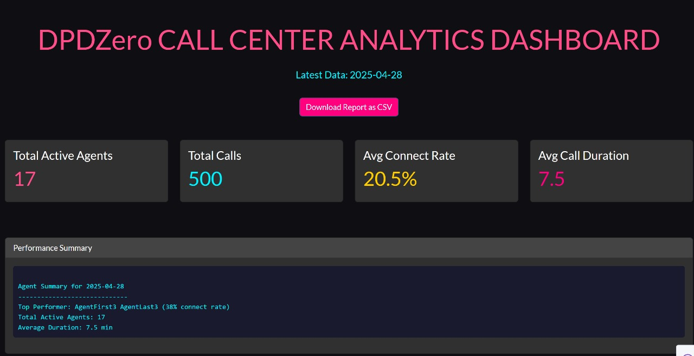
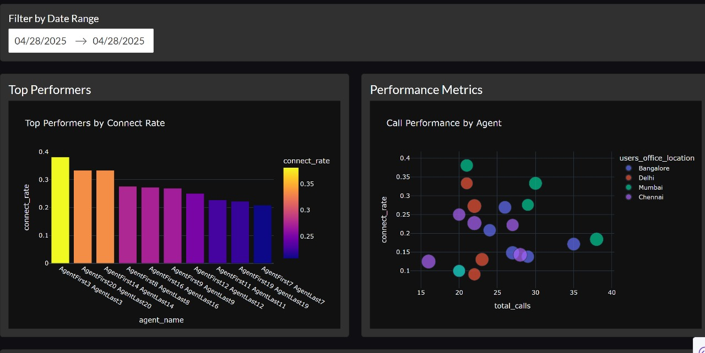
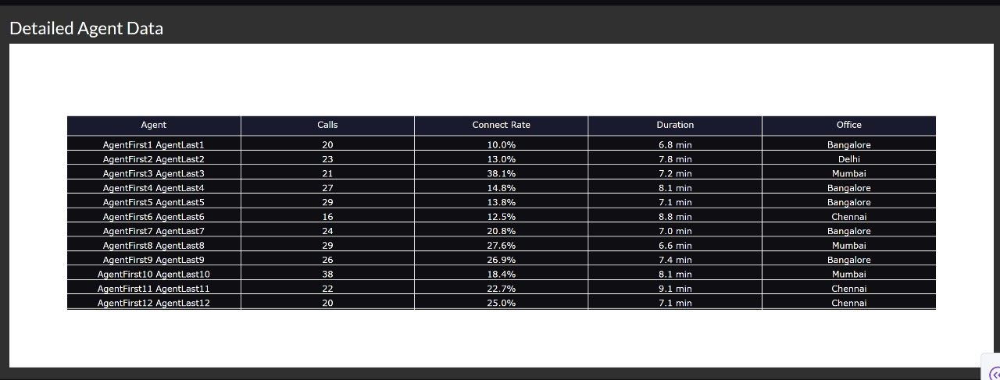

# Call Center Analytics Dashboard

An interactive web application built with Python and Dash to monitor call center operations, agent productivity, and daily call trends. It merges and processes over 50,000 records across three CSV datasets (`call_logs.csv`, `agent_roster.csv`, and `disposition_summary.csv`) to track throughput, connect rates, and call duration across 200+ agents.

## Features

* **Live KPI Overview:** Tracks Total Active Agents, Total Calls, Average Connect Rate, and Average Call Duration at a glance.
* **Interactive Date Filtering:** Filter the entire dashboard by date range to dynamically update KPI cards, charts, summaries, and tables.
* **Automated Daily Summary:** Generates a formatted, Slack-style performance digest highlighting the top performer by connect rate, active agent count, and average call duration.
* **Interactive Visualizations:**
  * **Top Performers Chart:** Bar chart ranking the top 10 agents by connect rate.
  * **Performance Scatter Plot:** Compares total call volume against connect rate, sized by average call duration and color-coded by office location.
  * **Agent Breakdown Table:** Detailed view of individual agent call counts, connect rates, average durations, and office locations.
* **One-Click CSV Export:** Download filtered and processed agent metrics directly as `agent_performance.csv`.

## Tech Stack

* **Data Processing:** Python, Pandas
* **Web Framework & UI:** Dash, Dash Bootstrap Components (`DARKLY` theme)
* **Data Visualization:** Plotly (`plotly.express`, `plotly.graph_objects`)

## Project Structure

```text
call-center-analytics-dashboard/
├── app.py                            # Main Dash application and data pipeline
├── call_logs.csv                     # Raw call records (timestamps, status, duration)
├── agent_roster.csv                  # Agent profiles and office locations
├── disposition_summary.csv           # Daily agent login and presence records
├── agent_performance_summary.csv     # Reference agent performance summary
├── dashboard-view-1.jpg              # Overview & KPIs
├── dashboard-view-2.jpg              # Performance Analytics
├── dashboard-view-3.jpg              # Detailed Agent Breakdown
├── requirements.txt                  # Python dependencies
└── README.md
```

> **Note:** Keep the CSV files in the same root directory as `app.py`, as the data loader reads them directly from the project root.

## Getting Started

1. **Clone the repository**
   ```bash
   git clone https://github.com/Disha-Saxenaa/call-center-analytics-dashboard.git
   cd call-center-analytics-dashboard
   ```

2. **Install dependencies**
   ```bash
   pip install -r requirements.txt
   ```

3. **Run the application**
   ```bash
   python app.py
   ```

4. **View the dashboard**
   Open your browser and navigate to `http://127.0.0.1:8050/`.

## Dashboard Screenshots

### Overview & KPIs


### Performance Analytics


### Detailed Agent Breakdown

